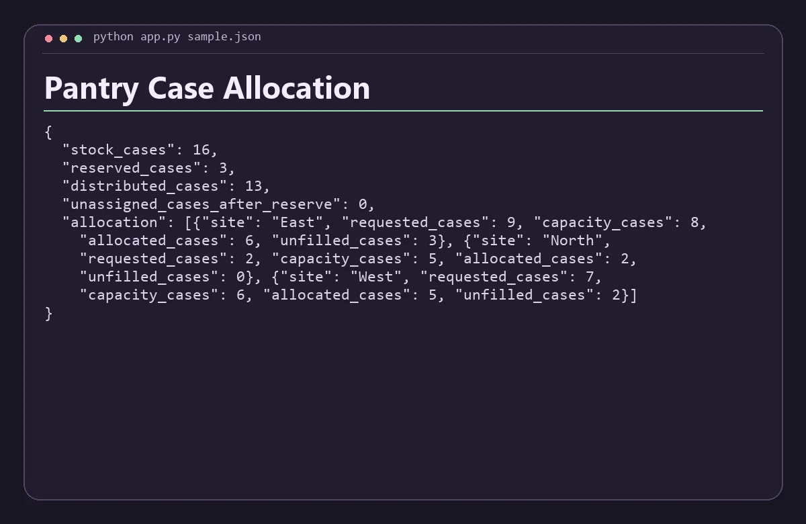

# Pantry Case Allocation

Split sealed cases of one item among partner pantries using equal shares, site requests, storage limits, and a central reserve.



## Run

Install Python 3.11 or newer. Run these commands from the repository root.

```sh
python app.py sample.json
```

Replace `sample.json` with a JSON file following the same structure. The app prints a JSON report to standard output.

Use whole cases of a single item. The planner holds back the reserve and caps each site at the smaller of its request and same-item storage capacity. It raises the uniform share as far as stock permits, then awards any remaining single cases in alphabetical site order. The report shows unfilled requests and stock left after the reserve.

## Verify

Run `python check.py` with Python 3.11 or newer after the build step when applicable. The check verifies the bundled scenario and confirms that an invalid input returns an error.
